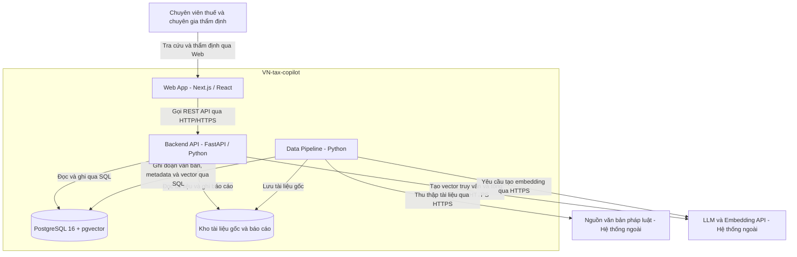

# C4 Level 2 — Container Diagram

## Phạm vi và trạng thái

Sơ đồ mô tả kiến trúc mục tiêu của VN-tax-copilot.

Trong nhiệm vụ ARC-01, PostgreSQL + pgvector đã được chạy thử
bằng Docker Compose. Các thành phần còn lại là thiết kế đề xuất,
chưa được xác nhận hoạt động qua bài kiểm tra database.

## Sơ đồ

## Trách nhiệm của các container

| Container | Công nghệ | Trách nhiệm |
|---|---|---|
| Web App | Next.js / React | Giao diện chat, xem trích dẫn, hồ sơ và thẩm định |
| Backend API | FastAPI / Python | Phân quyền, quản lý hồ sơ, điều phối RAG, kiểm tra trích dẫn và xuất báo cáo |
| Data Pipeline | Python | Thu thập, OCR, phân đoạn văn bản và chuẩn hóa metadata |
| Database | PostgreSQL 16 + pgvector | Lưu dữ liệu nghiệp vụ, đoạn văn bản, metadata, vector và audit log |
| Kho tệp | Chưa chốt công nghệ | Lưu tài liệu gốc và báo cáo xuất |

Các trách nhiệm trên là thiết kế mục tiêu; chưa khẳng định
các bảng dữ liệu và chức năng đã được triển khai.

## Quyết định và giả định kiến trúc

- pgvector là extension trong PostgreSQL, không phải service riêng.
- Module ai_engine được giả định chạy cùng tiến trình Backend.
  Nếu triển khai độc lập, cần tách thành một container trên sơ đồ.
- Data Pipeline được giả định là chương trình chạy riêng theo đợt.
  Hiện chưa có service tương ứng trong Docker Compose.
- Nhà cung cấp LLM, model embedding và số chiều vector chưa chốt.
- Kho tệp có thể dùng thư mục local hoặc object storage;
  nhóm cần thống nhất trước khi triển khai.
- Câu trả lời AI cần được chuyên gia thẩm định trước khi phê duyệt.

## Ánh xạ với Docker Compose hiện tại

| Service Compose | Thành phần C4 | Cổng trên máy local | Trạng thái kiểm tra |
|---|---|---|---|
| frontend | Web App | 3000 | Chưa kiểm tra |
| backend | Backend API | 8000 | Chưa kiểm tra |
| db | Database | 127.0.0.1:5432 | Đã chạy và bật pgvector |

- Backend trong cùng Compose kết nối database bằng hostname `db`,
  cổng `5432`.
- Công cụ chạy trực tiếp trên máy kết nối qua `localhost:5432`.
- Named volume `pgdata` lưu dữ liệu PostgreSQL.
- Backend được cấu hình chờ healthcheck của database thành công.
- Script `infra/postgres/init/001-enable-vector.sql` bật extension
  khi khởi tạo database mới với thư mục dữ liệu trống.
- Tài khoản và mật khẩu mặc định trong Compose chỉ phục vụ thử local.
  DATABASE_URL của Backend hiện ghi cố định; khi đổi thông tin
  database cần cập nhật cấu hình Backend tương ứng.

## Giới hạn

C4 Container mô tả ứng dụng và kho dữ liệu, không đồng nghĩa mỗi
thành phần trên sơ đồ đều đã có một Docker container đang chạy.