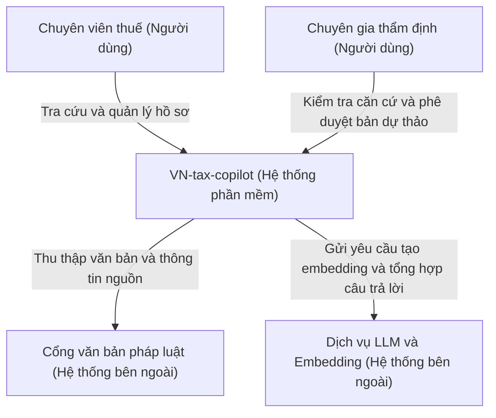

# C4 Level 1 — System Context

## Phạm vi

VN-tax-copilot hỗ trợ chuyên viên tra cứu pháp luật thuế Việt Nam,
tạo câu trả lời có trích dẫn và quản lý hồ sơ thẩm định.

Đây là kiến trúc mục tiêu đề xuất. Các kết nối bên ngoài chưa được
xác nhận triển khai trong phạm vi cấu hình database ARC-01.

## Sơ đồ

## Trách nhiệm

- Chuyên viên thuế: đặt câu hỏi, xem trích dẫn và lưu kết quả vào hồ sơ.
- Chuyên gia thẩm định: đánh giá và phê duyệt hoặc từ chối bản dự thảo.
- VN-tax-copilot: truy xuất tài liệu, tổng hợp câu trả lời có căn cứ,
  quản lý hồ sơ và trạng thái thẩm định.
- Nguồn văn bản: cung cấp tài liệu pháp luật để hệ thống thu thập.
- Dịch vụ AI: cung cấp khả năng tạo embedding và sinh câu trả lời.

## Giả định cần thống nhất

- LLM và embedding được gọi qua API bên ngoài; nhà cung cấp chưa chốt.
- Nếu nhóm tự triển khai model, cần cập nhật ranh giới hệ thống.
- Câu trả lời do AI tạo là bản dự thảo, cần chuyên gia thẩm định.